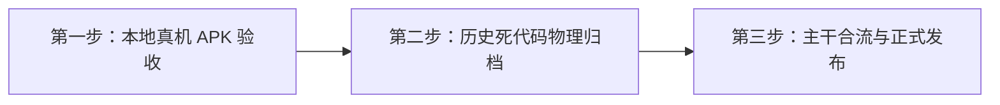

# Gorgon Lite 后续推进与落地实施方案

> 版本：v1.0.0-lite  
> 基线分支：`refactor/gorgon-lite-mvp`（HEAD: `c05a418`）  
> 维护责任：主负责工程智能体（Antigravity）  
> 仓库地址：`https://github.com/cvcingcvc-code/cec`

---

## 1. 核心定位与重构目标

Gorgon Lite 是由功能膨胀的 Gorgon Workbench 精简而来的**个人 AI 行动助手**。

产品严格围绕唯一的**核心业务闭环**运转：
$$\text{用户创建任务} \longrightarrow \text{AI / 电脑受控辅助执行} \longrightarrow \text{返回真实结果} \longrightarrow \text{保存记录与结构化复盘}$$

### 核心架构原则
1. **主入口聚焦**：移动端底部仅保留三大一级入口：**首页（`home`） / 任务（`tasks`） / 智能体（`agent`）**。
2. **数据绝不丢失**：日程、笔记、项目、工作记录/回收站、人工审批移出主底栏，收纳至顶部「工具」抽屉、任务页快捷栏及上下文详情中，所有历史键 100% 保持兼容读取。
3. **按需加载与性能收敛**：16 个次级与归档页面全量采用 `React.lazy` 动态导入，首屏主包降低 50%，首屏 JS 从 492KB 减至 249KB。
4. **诚实与安全底线**：严禁伪造 AI 执行成功；AI 未连接时如实展示；严格限制本地网关只读沙箱；提供 `?nav=classic` 零损耗经典回滚通道。

---

## 2. 当前已达成状态与里程碑

| 阶段 | 交付项 | 真实证据与指标 | 状态 |
|---|---|---|---|
| **Phase 0** | 分支审计与基线确认 | 基于包含 V3K+V3L+V3N 全集能力的 `7699b4a` 建立分支，无冲突 cherry-pick `f52059b` 补齐 License，未合并黑客松 PR #8；输出 `docs/GORGON_LITE_AUDIT.md` | **已完成** |
| **Phase 1** | 三入口重构与闭环打通 | `LiteChrome.jsx` 导航抽离、`WorkbenchHome.jsx` 聚焦一句话建任务、`TaskDetailScreen.jsx` 增加快捷复盘标签、`AgentScreen.jsx` 结果写回闭环打通 | **已完成** |
| **安全审计** | 全面漏洞审查与加固 | 1. 网关 Token 常数时间比对（防时序侧信道攻击）<br>2. WorkBuddy IPC 管道 2MB 缓冲上限与异常释放（防 OOM DoS）<br>3. 任务模型 `sanitizeMetadata` 属性清洗（防原型链污染）<br>4. 外部链接补充 `rel="noopener noreferrer"`（防 Tabnabbing）<br>5. Vite 开发/预览服务限定绑定 `127.0.0.1` | **已完成** |
| **测试验证** | 全套自动化回归 | 1. 前端全量单测：**638 项全绿**（637 pass, 1 skipped）<br>2. Python 管线测试：**488 项全绿**（487 pass, 1 skipped）<br>3. 生产打包安全扫描：**18/18 项通过**<br>4. 无头浏览器 E2E 闭环测试：**103/103 项通过**<br>5. Capacitor Android 原生同步：**成功** | **已完成** |

---

## 3. 后续推进推进方案（分步落地指引）



### 第一阶段：Android 物理真机核验与验收（当前状态：`NOT_TESTED`）

自动化测试与无头浏览器无法替代真实的 Android 物理设备体验。后续挂载物理手机时，按以下清单执行人工核验：

1. **打包测试 APK**：
   ```bash
   cd app
   npm run build:apk
   # 或进入 app/android 目录执行 ./gradlew assembleDebug
   ```
2. **5 步真机核验流程**：
   - **步骤 1（覆盖安装保数据）**：在装有旧版 APK 的手机上覆盖安装，验证原本地存储的历史任务、笔记、项目未发生丢失或格式错误。
   - **步骤 2（三入口窄屏触控）**：检查底部仅显示「首页 / 任务 / 智能体」，且按钮触控热区均 $\ge 48\text{px}$，在 360px、390px、412px 屏幕下均无横向滚动条。
   - **步骤 3（核心闭环持久化）**：在首页一句话输入目标（如「整理一份发布前检查单」）$\to$ 自动流转完成 $\to$ 任务详情添加 `[结果复盘]` 笔记 $\to$ 划掉杀掉 App 进程重新启动 $\to$ 确认任务、步骤与复盘笔记依然存在。
   - **步骤 4（智能体未连接诚实展示）**：未开启电脑端网关时进入「智能体」Tab，界面明确展示「未连接电脑」，且提交按钮处于禁用/安全提示状态。
   - **步骤 5（局域网受控联调）**：在电脑端执行：
     ```bash
     node scripts/agent-gateway.mjs --port 8765 --lan
     ```
     手机端填入电脑局域网 IP 与 配对 Token，测试「查看项目状态」执行成功，且结果可一键写回任务。

---

### 第二阶段：历史冻结模块与死代码物理归档（Phase 2）

当前为保证向后兼容，历史模块采用 UI 隐藏与懒加载方式处置。第二阶段推进物理文件瘦身：

1. **未挂载孤立代码归档**：
   - `app/src/store/job-repository.js` 与 `job-model.js`（从未挂载于任何 UI 界面）：移动至 `app/src/archived/jobs/` 或物理归档。
   - `ProgressCenterScreen.jsx`：与现有项目详情页完全重叠，将其正式归入归档目录。
2. **早期 Babel 运行时清理**：
   - 根目录下 `ui_kits/`（早期未构建的旧版前端与 Babel 运行时）：归档至 `archived/legacy-ui-kits/`。
   - 根目录下 `styles.css` 与 `_ds_bundle.js`：由于现代 Vite 工程全部在 `app/` 内自包含打包，可将根目录旧样式文件整理归档。
3. **数据采集管线与桌面壳解耦**：
   - `pipeline/`（Python 爬虫与索引）与 `desktop/main.py`（pywebview）作为独立伴生工具保留在顶层，明确文档界限，不污染 `app/` 移动端核心依赖。

---

### 第三阶段：主干分支受控合流与发布（Phase 3）

由于 GitHub `master` 停留于历史提交 `f52059b`，合流必须按以下规程受控执行：

1. **建立评审 PR**：
   - 从 `refactor/gorgon-lite-mvp` 向 `master` 或 `feature/gorgon-opportunity-v2` 发起 Pull Request；
   - PR 描述中清晰附带：
     - 四分类资产处置表（KEEP / HIDE / ARCHIVE / REMOVE_CANDIDATE）；
     - 638 项 Node 单测与 103 项 E2E 测试全绿报告；
     - 5 项安全加固清单；
     - `?nav=classic` 经典回滚说明。
2. **合并后基线打标签**：
   - 合流后打正式标签 `v1.0.0-lite`；
   - 历史 PR #7（真机修复）已完全包含在当前链中，可标记关闭；
   - 历史 PR #8（黑客松扩张）继续保持关闭/冻结，避免主干膨胀。

---

## 4. 持久化数据兼容与回滚契约

任何时候若用户或开发团队需要回滚至旧版导航，无需修改代码或重装，提供双重保障：

1. **运行时一键回滚**：
   - 界面操作：应用右上角「模型与设置」$\to$ 点击「回滚为旧版完整导航」；
   - URL 操作：浏览器访问 `/?nav=classic` 或 `/?legacy=1` 即可恢复旧版 12 Tab / 5 入口。
2. **受保护的持久化键列表（禁止直接删除或破坏其结构）**：
   - 任务主干：`gorgon_workbench_tasks_v2`（损坏时自动备份为 `.corrupt-n`，绝不清空）
   - 任务迁移源：`gorgon_workbench_tasks`
   - 提醒记录：`gorgon_notified_reminders_v1`
   - 笔记与项目：`gorgon_workbench_opportunities_v1`、`gorgon_workbench_projects_v1`
   - 人工审批与日志：`gorgon_workbench_proposals_v1`、`gorgon_workbench_log`
   - 网关配置与镜像：`gorgon_agent_gateway_url`、`gorgon_agent_gateway_token`、`gorgon_agent_runs_mirror_v1`
   - 模式切换偏好：`gorgon_nav_mode`
