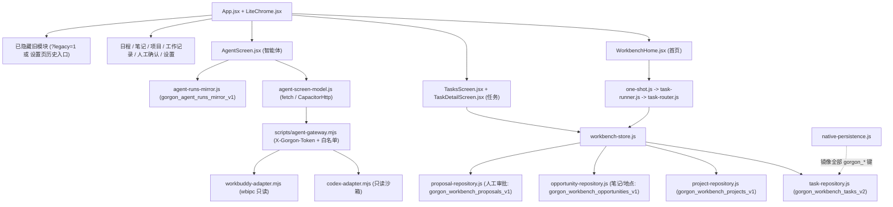

# Gorgon Lite 接手审计、依赖图谱与架构基线（CURRENT STATE）

> 审计日期：2026-11-18
> 接手分支：`refactor/gorgon-lite-mvp`（基于 `7699b4a` + cherry-pick `f52059b`）
> 本文件同时承担 `AGENTS.md` 所需的当前真实状态单一事实来源（替代历史缺失的 `docs/CURRENT_STATE.md`）。

---

## 1. 仓库、分支拓扑与未合并 PR 审计结论

### 1.1 工作树与远端基线

- **唯一正式 GitHub 仓库**：`https://github.com/cvcingcvc-code/cec`
- **宿主机原始工作树保护**：宿主机 `F:\Gorgon-Workbench` 挂载了 10 个历史 `git worktree` 且当前索引处于 `feat/hackathon-discovery-v1` 未提交变更状态。按安全接手原则与全局开发规范（严禁在 C 盘开发），**未修改、未清理宿主机任何原有工作树**；开发与验证均在非系统盘合规工作区 `E:\Projects\cec` 的独立分支 `refactor/gorgon-lite-mvp` 上执行。

### 1.2 核心分支线性演进核实（关键发现）

通过 `git log` 祖先关系验证，真实提交拓扑如下：

```
8cd4ec4 (cec/feature/gorgon-opportunity-v2, tag: v0.3.7-alpha)
 ├── f52059b (cec/master) —— 仅新增 MIT LICENSE 并移动 4 份 recovery 报告（落后主开发链 38 次提交！）
 └── e2514af (cec/feat/v3i-android-full-delivery)
      └── 5b2ea10 ← 合并 cec/feat/v3k-android-ui-redesign (bb5e44d, Obsidian UI)
           └── 907088c (cec/feat/v3j-device-fix, Open PR #7: DatePicker 崩溃修复 / 时区偏移修复 / 笔记新建 / CI)
                └── 8a407d7 (cec/feat/v3l-pc-agent-controller: WorkBuddy wbipc 只读适配 / Companion / CapacitorHttp 局域网修复 / V3M 路由与部分成功)
                     └── 7699b4a (cec/feat/one-shot-agent-experience-v1, tag: v0.3.13-alpha: V3N 一句话原子提交 / 去重 / 失败步骤单步重试)
                          └── 5a0956f (cec/feat/hackathon-discovery-v1, Open PR #8: V2.4/V2.5 黑客松抓取与匹配扩张 —— 本轮冻结不纳入)
```

**基线选型决策**：
- 若直接从 `master` (`f52059b`) 切分支，将丢失 V3I、V3J（P0 日期闪退与 UTC 时区偏移修复）、V3K（Obsidian 移动 UI）、V3L/V3M（电脑端 Agent Controller + Android `CapacitorHttp` 混合内容修复 + 任务路由）及 V3N（一句话原子执行与重试恢复）。
- 若从 PR #8 (`5a0956f`) 切分支，则会混入黑客松爬虫与赛事匹配扩张代码。
- 因此，`refactor/gorgon-lite-mvp` 以 **`7699b4a` (`v0.3.13-alpha`)** 为起点，并无冲突 cherry-pick `master` 独有的 `f52059b`（补齐 `LICENSE` 与 `docs/recovery/` 归档），既完整保留 V3K + V3L + V3N 全部已验证能力，又不引入黑客松扩张模块。
- **未合并 PR 状态**：PR #7 (`feat/v3j-device-fix` → `feature/gorgon-opportunity-v2`, OPEN)、PR #8 (`feat/hackathon-discovery-v1` → `master`, OPEN) 均保持原状未合并。

---

## 2. 真实能力矩阵（拒绝夸大）

| 模块 / 能力 | 状态分级 | 真实代码与测试证据 | 边界与限制 |
|---|---|---|---|
| 任务引擎 v2（7 态状态机 + 时间线 + 软删回收站） | **已证实可用** | `task-model.js` / `task-repository.js`，单测全绿 | 纯本地存储，跨设备不自动同步 |
| 一句话建任务并自动路由执行（One-Shot） | **已证实可用** | `one-shot.js` / `task-runner.js` / `task-router.js`（确定性提取/规划/摘要/写作 + 幂等去重 + 失败步骤重试） | 无云端大模型密钥时走确定性本地规则，不伪装成 AI 生成 |
| 任务排期、冲突检测、应用内到期提醒 | **已证实可用** | `DatePickerSheet.jsx`（V3J 修复闪退与 UTC 偏移）、`reminder-fire.js` | Web 环境仅应用内提示；Android 系统通知需真机授权验证 |
| 笔记、项目与任务双向关联及 TXT/MD 导入 | **已证实可用** | `opportunity-repository.js` / `project-repository.js` / `note-import.js` | 导入严格只追加不覆盖（2MB 上限） |
| PC Agent Gateway（局域网只读执行 + 配对鉴权 + 审计 + 取消） | **已证实可用（本机/局域网 HTTP）** | `scripts/agent-gateway.mjs`（默认绑 `127.0.0.1`，`--lan` 显式放开，`repo.status` / `repo.readDoc` / `host.stats`） | 无任意命令执行；公网穿透未开发 |
| WorkBuddy 桌面端状态探测与受限只读 IPC 查询 | **已证实可用（本机命名管道只读）** | `workbuddy-adapter.mjs` + `wbipc-client.mjs`（4 项只读查询：`describe_ipc` / `read_accounts` / `read_profile` / `list_cloud_agents`） | 仅限本机已安装并登录 WorkBuddy；发消息与写操作明确拒绝（`BLOCKED_UNSUPPORTED_OPERATION`） |
| Codex CLI 只读项目诊断适配器 | **阻断（网络/代理环境）** | `codex-adapter.mjs` 代码与注入防护测试通过；真实 CLI 调用在当前网络环境下连接 OpenAI 超时（`BLOCKED_NETWORK`） | 需本机已安装登录 Codex CLI 且代理/网络可达，失败如实报错 |
| Android 原生持久化镜像与 `CapacitorHttp` 局域网通路 | **代码存在但未真机验收（`NOT_TESTED`）** | `native-persistence.js` 单元测试通过；`agent-screen-model.js` 原生 HTTP 分支代码就绪 | 物理 Android 手机覆盖安装、系统通知触发、Wi-Fi 连电脑待人工真机核验 |
| Jev 判断引擎 / 跨设备云端记忆 / 业务自动化 | **仅规划** | 仅存在于 `docs/ROADMAP.md` / `docs/AGENT_REMOTE_DESIGN.md` | 本轮冻结，不开发 |
| 周末活动发现 / 豆瓣数据快照 / 模拟路线 | **历史演示 / 归档** | `DiscoverScreen` / `SearchScreen` / `MapScreen` / `pipeline/` | UI 已从主导航隐藏，保留设置页历史数据访问入口与 `?legacy=1` 契约 |

---

## 3. 调用链、持久化键与模块依赖关系



### 不可破坏的持久化键清单（全部保留原名与兼容读取）

- 任务核心：`gorgon_workbench_tasks_v2`、旧版自动迁移源 `gorgon_workbench_tasks`、提醒去重 `gorgon_notified_reminders_v1`
- 笔记/项目/审批/日志：`gorgon_workbench_opportunities_v1`、`gorgon_workbench_projects_v1`、`gorgon_workbench_proposals_v1`、`gorgon_workbench_review`、`gorgon_workbench_progress_v1`、`gorgon_workbench_log`
- 智能体连接与记录镜像：`gorgon_agent_gateway_url`、`gorgon_agent_gateway_token`、`gorgon_agent_runs_mirror_v1`
- 历史模块存档（隐藏入口但保留读取）：`gorgon_workbench_user_activities_v1`、`gorgon_my_weekend_items`、`gorgon_favorites`、`gorgon_selected_district`
- Android 原生镜像：`Capacitor Preferences` 下所有 `gorgon_*` 与 `gorgon__rev_*` 键
- 新增轻量偏好键：`gorgon_nav_mode`（`"lite"` 默认 | `"classic"` 回滚）

---

## 4. 四分类资产处置表（Phase 0 决议）

| 分类 | 模块 / 路径 | Phase 1 实际动作 |
|---|---|---|
| **KEEP（主入口）** | `WorkbenchHome.jsx`、`TasksScreen.jsx`、`TaskDetailScreen.jsx`、`AgentScreen.jsx`、`LiteChrome.jsx`、`navigation.js`、`one-shot.js`、`task-*.js`、`reminder-*.js`、`agent-gateway.mjs` 及适配器 | 精简重构为 **首页 / 任务 / 智能体** 三主入口，打通任务详情 ↔ 智能体上下文写回与结构化复盘闭环 |
| **KEEP（次级可达，不丢数据）** | `ScheduleScreen.jsx`、`NotesScreen.jsx`、`ProjectsScreen.jsx`、`ProjectDetailScreen.jsx`、`HistoryScreen.jsx`、`ReviewCenterScreen.jsx`、`SettingsScreen.jsx` | 移出移动端底栏，收纳至顶部「工具」面板、任务页快捷栏、任务详情与设置页，并改为 `React.lazy` 按需加载 |
| **HIDE（默认隐藏，保留恢复通道）** | `DiscoverScreen`、`SearchScreen`、`NaturalSearchScreen`、`MyWeekendScreen`、`MapScreen`、`PlacesScreen`、`UserActivitiesScreen`、`ProgressCenterScreen` + `hooks/useArchivedState.js` | 状态与回调从 `App.jsx` 抽离至 `useArchivedState.js`（`App.jsx` 由 1,238 行降至 557 行，主 JS 包由 `492.61 kB` 降至 `249.45 kB`）；在「设置 → 已隐藏模块与历史数据入口」及 `?legacy=1` / `?nav=classic` 保留完整访问 |
| **ARCHIVE（冻结，下轮归档评估）** | `pipeline/`（Python 活动采集与检索服务）、`desktop/main.py`（pywebview 桌面壳）、`ui_kits/`（早期 Babel 前端）、`reports/` 历史报告 | 源码冻结不扩张（仅修正 `test_store.py` 1 处固定日期单测参数使 488 项 Python 测试全绿）；静态活动数据拆分为独立 `archived-data` 分包 |
| **REMOVE_CANDIDATE（仅标记，本轮不删）** | 未合并 PR #8 黑客松模块（未引入本分支）、未挂载 UI 的 `job-repository.js` / `job-model.js`、与项目页重叠的 `ProgressCenterScreen.jsx` | 仅记录为后续迭代清理候选，本轮不删除任何源码文件 |

---

## 5. 测试断言变更说明与回滚方案

### 5.1 测试契约说明

- **完全保留的安全与数据契约**：7 态任务状态机、v1→v2 自动迁移、损坏存储隔离备份、One-Shot 幂等与部分成功重试、Gateway Token 鉴权与注入拦截、`AgentScreen` 48px 触控与 150% 字号防溢出、`/?legacy=1` 旧版五入口契约。
- **随产品精简同步更新的旧导航断言**：`app/tests/workbench-shell.test.mjs` 与 `app/tests/e2e_workbench_shell.mjs` 中原先断言「Workbench 12 个一级 Tab」及「移动底栏固定含『搜索』四按钮」的用例代表已冻结的旧版膨胀导航；现已更新为断言 **Gorgon Lite 三主入口（首页/任务/智能体）+ 次级工具无重复 + 归档模块可达 + `?nav=classic` 完整回滚契约**。

### 5.2 一键回滚方法

1. **运行时无损回滚导航**（不改代码、不丢数据）：
   - 在应用右上角进入「模型与设置」→ 点击「回滚为旧版完整导航」；或
   - 浏览器访问 `/?nav=classic`。
2. **代码分支级回滚**：
   - 本轮全部改动均位于独立分支 `refactor/gorgon-lite-mvp`，`master` (`f52059b`) 与 `v0.3.13-alpha` (`7699b4a`) 未做任何改动，随时可 `git checkout` 切回。

---

## 6. Android 真机验收步骤（当前状态：`NOT_TESTED`）

桌面与无头浏览器测试不能替代 Android 物理真机验收。后续在真机安装测试包时，请按以下 5 步核验：

1. **覆盖安装保数据**：在装有旧版正式签名 APK 的手机上直接覆盖安装，确认历史任务、笔记、项目未丢失。
2. **三入口与窄屏布局**：检查底部仅显示「首页 / 任务 / 智能体」，右上角可打开「工具」与「设置」，无横向滚动条。
3. **主闭环持久化**：在首页输入「帮我整理一份交付前核对清单」→ 自动生成结果 → 在详情页设提醒并记一笔复盘 → 划掉杀进程重开 App，确认状态、结果与复盘笔记完整保留。
4. **智能体未连接诚实提示**：未开电脑网关时进入「智能体」页，确认明确显示「未连接电脑」且无法误点提交。
5. **局域网受控连接与取消**：电脑端运行 `node scripts/agent-gateway.mjs --port 8765 --lan`，手机填入局域网地址与配对码，验证 `查看项目状态` 执行成功、结果可关联回本地任务。
